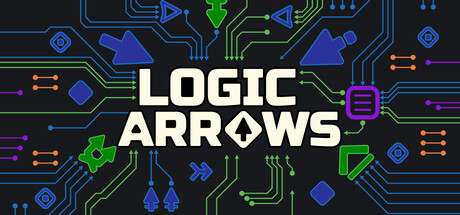

# Logic Arrows API
[](https://store.steampowered.com/app/4210250/Logic_Arrows/)
[](https://www.npmjs.com/package/logic-arrows-api)
[](LICENSE)
<br/>

<a href="https://store.steampowered.com/app/4210250/Logic_Arrows/"></a>

TypeScript declarations for the script block API of
[Logic Arrows](https://store.steampowered.com/app/4210250/Logic_Arrows/). They give you
autocompletion, inline documentation and type checking when you write the code of a script block
in an external editor.

This is an unofficial package, published with the permission of the author of the game. It is an
early version: everything it describes has been checked in the game, but the API of the game is
still growing, and the declarations may change.

## Install

```
npm install --save-dev logic-arrows-api
```

## Use

The API of a script block is global: `world`, `game`, `always`, `onActive` and the others are
available without an import. Add the package to the `types` of your `tsconfig.json`, or of your
`jsconfig.json` if you write plain JavaScript:

```json
{
  "compilerOptions": {
    "types": ["logic-arrows-api"]
  }
}
```

Or reference it at the top of a single file:

```js
/// <reference types="logic-arrows-api" />
```

After that the editor knows the API:

```js
let count = 0;

onActive(event => {
  count++;
  showText('Activated **' + count + '** times, last at tick ' + event.tick + '.');
});
```

## Reference

The whole API is described in [script-api.d.ts](script-api.d.ts). You can read it right here,
without installing anything.

## License

[MIT](LICENSE)
